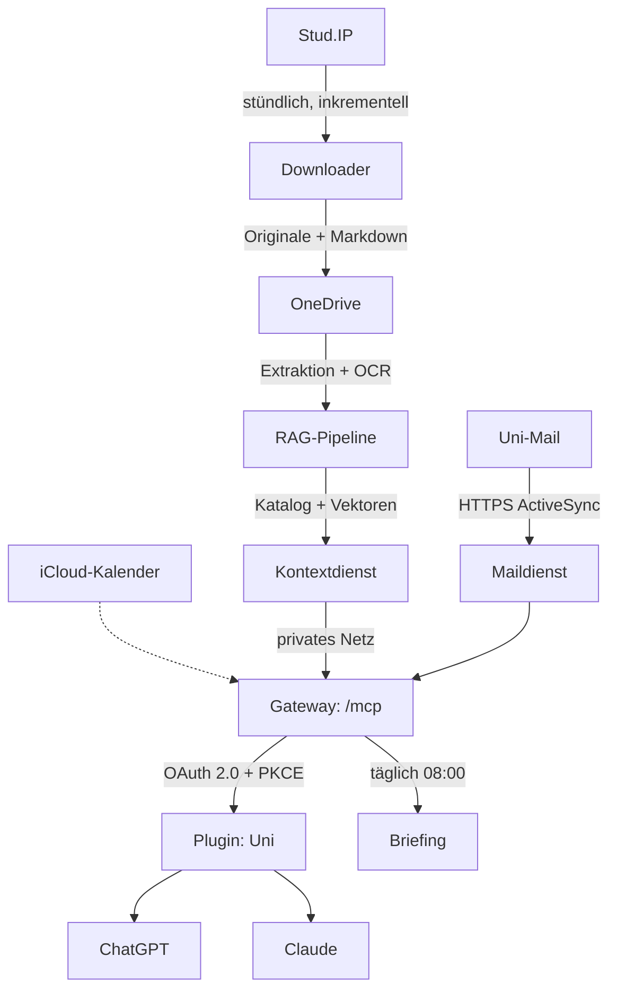
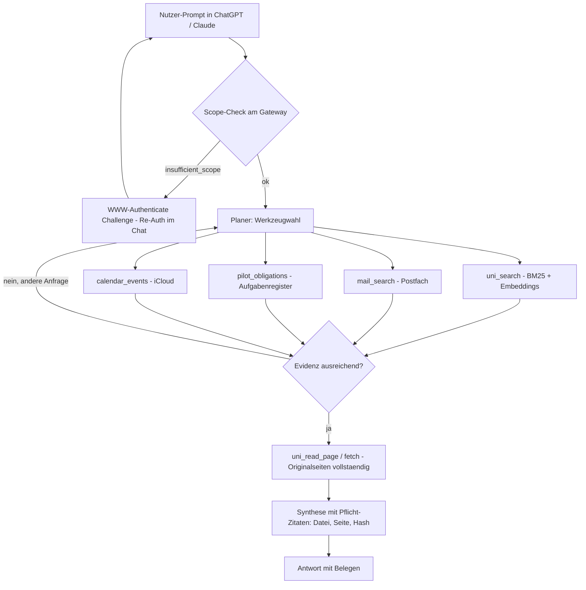

<p align="center"><br></p>

**Dein Uni-Betrieb, direkt in der ChatGPT-App, die du eh schon nutzt.**

Das System zieht Kursmaterial automatisch aus Stud.IP, macht es semantisch durchsuchbar und hängt Kurse, Mail, Kalender und Aufgaben als **ein einziges privates Plugin** an ChatGPT, Claude und andere LLM-Clients an.

**Kein neues Tool. Kein Dashboard. Kein weiterer Login.** Du öffnest nichts - du schreibst einfach im normalen Chat, wie du es jeden Tag tust. Das Plugin ist die Oberfläche.

## Das Problem

<p align="left"><br><sub><i>so fühlt sich das an</i></sub></p>

1. **Stud.IP ist ein Klick-Marathon.** Jede neue Folie einzeln laden, Ordner pflegen, nie sicher, ob der Bestand vollständig ist.
2. **LLM-Antworten ohne Beleg.** ChatGPT erklärt Ökonometrie aus dem Gedächtnis - nicht aus *deinen* Unterlagen, ohne Seitennachweis.
3. **Uni-Wissen ist verteilt.** Mails im Postfach, Fristen in PDFs, Termine im Kalender, Planung in Excel. Niemand sagt dir um 8 Uhr, was heute ansteht.

## Die Rechnung (grob, konservativ)

Ein normales Semester - ~6 belegte Kurse, geschätzt ~150 neue oder aktualisierte Dateien (im Schnitt ~25 Dateien pro Kurs, gemessen an ~1.300 Dateien auf 53 Kursen):

| Was | Rechnung | Klicks |
| --- | --- | --- |
| Neue/aktualisierte Dateien laden | ~150 × ~4 Klicks (Kurs öffnen → Dateien → Ordner → Download/Speichern) | ~600 |
| Wöchentlich auf Neues prüfen | 6 Kurse × 15 Semesterwochen × ~4 Klicks | ~360 |
| **Summe pro Semester** | | **~1.000** |
| **Über 6 Bachelor-Semester** | | **~6.000** |
| Mit diesem System | stündlich automatisch, inkrementell | **0** |

Der eigentliche Unterschied ist aber die Suchkosten-Minute. **Vom „ich will es wissen" zur Antwort:**

| | klassisch | mit diesem System |
| --- | --- | --- |
| Ablauf | Stud.IP anmelden → Kurs suchen → Dateibereich öffnen → PDF laden → Download-Ordner → im 200-Seiten-Skript suchen → *falsches Dokument, von vorn* | einen Prompt im Chat |
| Zeit bis zur Antwort | ~5–10 Minuten pro Frage | Sekunden |
| Beleg | hoffentlich die richtige Seite | jede Antwort mit Datei, PDF-Seite und Hash |
| Ablage | Download-Ordner mit `Skript.pdf`, `Skript (1).pdf`, `Skript_final_final2.pdf` | OneDrive: jede Datei genau einmal, nach Kurs geordnet, alte Versionen sauber archiviert statt umbenannt |

Über eine Lernwoche mit ein paar solcher Nachschau-Fragen sind das leicht 30–60 Minuten gesuchte Zeit - pro Woche. Das System bezahlt sich nicht in Klicks, sondern in *sofort belegtem Wissen*.

<p align="right"><br><sub><i>findet die Seite, bevor du fertig gescrollt hast</i></sub></p>


Und die Kontostands-Rechnung zeigt, wohin das langfristig geht: Über das ganze Studium sind es schnell 50+ Kurse und vierstellige Dateizahlen (hier gemessen: 53 Kurse, ~1.300 Dateien) - genau der Bestand, den der Downloader vollautomatisch verwaltet.

Damit ist das Problem kein Nichending: Rund **18.700 Studierende** an der Uni Bremen allein (WS 2025/26) müssen denselben Klick-Marathon in Stud.IP absolvieren - und Stud.IP steht bundesweit an weit über hundert Hochschulen. Jede:r Einzelne wiederholt dieselbe manuelle Schleife, obwohl sie sich zu 100 % automatisieren lässt.

## Die Lösung

Ein Downloader zieht Stud.IP stündlich und inkrementell nach OneDrive. Eine RAG-Pipeline erschließt jedes Dokument - inklusive gescannter PDFs per OCR. Ein Gateway bündelt alles zu **genau einem authentifizierten MCP-Endpunkt**: Das LLM sucht in echten Kursquellen mit Seitenzitat, liest dein Postfach, kennt deine Fristen und bereitet jeden Morgen um 08:00 dein Briefing vor.

## Cloud-nativ by design

Alles läuft auf Railway - **kein eingeschalteter Laptop nötig**. Das Briefing um 08:00 Europe/Berlin ist eine ChatGPT-Cloud-Aufgabe und kommt aufs Handy, egal ob dein Mac an oder aus ist.

| Aufgabe | Wo |
| --- | --- |
| Stud.IP-Abruf (stündlich, inkrementell) | Railway-Cron |
| Extraktion, OCR, Katalog | Railway |
| Suchindex + Embeddings | Railway (persistente Volumes) |
| Uni-Mail (Abruf, Einordnung, Entwürfe) | Railway |
| Gateway / MCP-Endpunkt | Railway |
| Tägliches Briefing 08:00 | ChatGPT Cloud |
| Lokale Weboberfläche, lokaler Skill | optional - reine Clients |

<p align="right"><br><sub><i>schläft tief und fest, während Railway die Nachtschicht fliegt</i></sub></p>




## Wie der Stud.IP-Abruf funktioniert

Kein Scraping, kein Browser-Getrickse: Der Downloader spricht die offizielle Stud.IP-JSON:API (`/jsonapi.php/v1/`) direkt an - dieselbe Schnittstelle, die die Web-Oberfläche nutzt.

1. **Kurse:** `GET /users/me` → alle belegten Kurse (paginiert).
2. **Dateien:** pro Kurs `file-refs` (Metadaten: Name, Größe, Änderungsdatum, Rechte) und `folders` (Ordnerbaum).
3. **Inkrementell:** Versionskarte `{Änderungsdatum, Größe, Name, Datei-ID}` gegen das Lauf-Manifest - unveränderte Dateien werden übersprungen. Altbestand wurde per Metadaten aus OneDrive „adoptiert", nicht neu geladen.
4. **Neues laden:** `/file-refs/{id}/content`, SHA-256 beim Streamen, Größen- und PDF-Header-Prüfung, atomarer Abschluss.
5. **Sicher abgelegt:** Upload per rclone mit automatischer Versionierung ins Archiv - nie ein Original überschreiben ohne Backup. Jeder Lauf liest eine hochgeladene Datei byte-für-byte zurück und vergleicht den Hash.
6. **Bericht:** maschinenlesbarer Report plus lesbarer Status und Kursindex nach OneDrive.

Strikt lesend: keine Kurseintragung, keine Schreibzugriffe. Fehler mit 408/429/5xx werden bis zu fünfmal mit Backoff wiederholt; hartnäckige Serverfehler (z. B. einzelne Dateien mit HTTP 500) bleiben im Report sichtbar und werden im nächsten Lauf erneut versucht.

<p align="right"><br><sub><i>fliegt die PDF-Fracht stündlich ein - bei jedem Wetter</i></sub></p>


## Warum das technisch interessant ist

- **Hybride Suche:** SQLite FTS5/BM25 + OpenAI-Embeddings (`text-embedding-3-small`), fusioniert per Reciprocal Rank Fusion. Findet Inhalte, die das Suchwort nicht enthalten.
- **Belegpflicht statt Halluzination:** Jeder Treffer trägt Kurs, Originalpfad, PDF-Seite und SHA-256. Das LLM zitiert Quellen, die du per Klick prüfen kannst.
- **OCR-Pipeline:** PDFs ohne Textebene werden mit `ocrmypdf`/`tesseract` (deu+eng) erschlossen und markiert.
- **Robuster Embedding-Betrieb:** Content-Hash-Cache, resume-fähig über Restarts, sauberes Rate-Limit-Handling gegenüber der OpenAI-API.
- **MCP als Schnittstelle:** Streamable HTTP, OAuth 2.0 mit PKCE und rotierenden Refresh-Tokens, dynamische Client-Registrierung, **pro Werkzeug OAuth-Scopes** mit Re-Autorisierung zur Laufzeit.
- **Agenten-sicherer Mailversand:** Dreistufig und hart abgesichert - Entwurf → frische Vorschau → Versand nur mit frischem Bestätigungstoken und ausdrücklichem Einzelauftrag.
- **Kalender-Abgleich mit Konflikterkennung:** Belegte Terminserien aus der verbindlichen Planung gegen iCloud prüfen; Schreibzugriff standardmäßig deaktiviert.

## Der Agent-Graph

Das Plugin ist kein simpler Request-Response-Endpunkt - der verbundene Client plant Werkzeugaufrufe als Graph: paralleler Fan-out, Evidenz-Check, Schleife bis die Belege stimmen, und Re-Autorisierung als Conditional Edge.



Jeder Treffer traegt Kurs, Originalpfad und SHA-256 - der Graph liefert keine Antwort ohne Rueckverfolgbarkeit.

## Stack

Python · FastMCP · SQLite FTS5 · OpenAI Embeddings · Railway · OneDrive · rclone · ocrmypdf/tesseract · openpyxl

## Komponenten

| Pfad | Aufgabe |
| --- | --- |
| `railway-studip-sync/` | Stud.IP-Downloader, inkrementeller Index, OCR |
| `remote-rag/` | Kontextdienst: Suche, Seitenwerkzeuge, Embeddings |
| `uni-gateway/` | Gemeinsamer MCP-Endpunkt, Routing, Kalender, Briefing |
| `uni-mail/` | Maildienst: ActiveSync, Einordnung, Entwürfe, Aufgabenregister |
| `uni-pilot/` | Diagnose-Collector für Briefing-Eingangsdaten |
| `uni-rag/` | Lokaler Indexclient und Weboberfläche |
| `skills/uni-kontext/` | Lokaler Kontext-Skill |
| `plugins/uni/` | Plugin-Manifest |
| `docs/` | Architektur, Betrieb, Status |
| `scripts/`, `tests/` | Prüfungen und künstliche Testdaten |

## Status

- **Live:** Lesen über ChatGPT (Suche mit Seitenzitaten, Systemstatus, Briefing), Mailabruf, authentifizierter ActiveSync-Transport.
- **Deploy-ausstehend:** Schreib- und Versandkette (entwickelt, getestet, vom Nutzer autorisiert) - ein Wächter deployed und prüft automatisch, sobald Railway wieder Builds annimmt; danach persönliche Freigabe, Plugin-Umschaltung und Testmail.
- **Läuft kontinuierlich:** Stündlicher Stud.IP-Abruf, RAG-Backfill (~120 Dateien/Lauf), Embedding-Ausbau.

Aktueller Detailstand: [docs/STATUS.md](docs/STATUS.md).

## Entwicklung

```sh
python3 -m venv .venv
. .venv/bin/activate
python3 -m pip install -r remote-rag/requirements.txt
python3 scripts/check_repository.py
python3 scripts/check.py
```

95 Offline-Tests mit künstlichen Daten. Produktionszugänge, Kursinhalte und Mailtexte gehören niemals ins Repository.

## Dein Uni-Tag in der ChatGPT-App

Kein neues Tool lernen, kein Dashboard pflegen - du fragst einfach im normalen Chat. Das Plugin versteht dein ganzes Uni-Leben; die App selbst bleibt die einzige Oberfläche:

**Morgens, vor der ersten Vorlesung**
> „Gib mir mein Uni-Briefing."

Postfach, offene Fristen, heutige Termine mit Raum, Index- und Abrufstatus - gelesen aus allen Quellen, Konflikte sichtbar markiert. Um 08:00 kommt es sogar von allein, auch wenn dein Laptop aus ist.

<p align="right"><br><sub><i>um 08:00 beim Briefing, Kaffee zuerst</i></sub></p>


**Vor der Übung**
> „Was hab ich heute und wo? Was muss ich vorbereitet haben?"

Das LLM liest deinen Kalender und sucht in den aktuellen Unterlagen - mit Seitennachweis statt Bauchgefühl.

**Beim Lernen**
> „Erkläre mir Instrumentvariablen anhand meiner Unterlagen."

Antwort aus *deinen* Kursdateien, jedes Zitat mit Datei und PDF-Seite - nachprüfbar per Klick, keine erfundenen Seitenzahlen.

**Wenn eine Uni-Mail reinkommt**
> „Fass mir die wichtigen Mails zusammen und was ich tun muss."

Einordnung, Fristen mit Beleg - und auf Wunsch ein fertiger Antwort-Entwurf in deinem echten Postfach (Versand nur nach deinem ausdrücklichen Einzelauftrag).

**Beim Organisationstrubel**
> „Was steht diese Woche an und was hab ich noch offen?"

Aufgabenregister mit Erledigungshistorie, belegte Fristen aus den Quellen, Vorlaufzeiten als Vorschlag.

**Kurz vor der Prüfung**
> „Such alles zu Hypothesentests in Statistik und zeig mir die Originalseiten."

Hybride Suche über Folien, Skripte und Altklausuren - Fundstellen vollständig lesbar.

## Auch im Tutorium: geprüftes Wissen statt Bauchgefühl

Als Tutor:in oder Übungsleitung ist das System ein zweites Gehirn mit Belegpflicht - es kennt *dein* Skript, *deine* Folien, *deine* Altklausuren, und antwortet nur daraus:

<p align="left"><br><sub><i>vier Quadranten, keine Kompromisse</i></sub></p>

**Vorbereitung**
> „Erstelle aus Kapitel 4 des Skripts fünf Verständnisfragen mit Musterlösung."

Jede Frage mit Seitennachweis - vor dem Tutorium in einer Minute gegengeprüft.

**Wiederkehrende Studentenfragen**
> „Ein Student verwechselt Konsistenz mit Effizienz - erkläre den Unterschied anhand unserer Unterlagen."

Antwort aus dem geprüften Kursmaterial, nicht aus dem Modellgedächtnis.

**Übungsblätter**
> „Baue ein Blatt zu Hypothesentests aus den Aufgaben der letzten drei Jahre, aufsteigend schwierig."

**Und weil es die ChatGPT-App ist, gilt:** Alles, was die App kann, geht auch mit deinem Uni-Wissen - am Handy zwischen zwei Sitzungen, diktiert statt getippt, unterwegs per Sprache. Kein separates Tool, kein Export-Zirkus, kein Copy-Paste zwischen fünf Fenstern.

Der Kern für Lehrende: Antworten, die du weitergeben kannst, weil jede Aussage auf eine Originalseite in *deinen* Unterlagen zeigt - statt auf das Wunschwissen eines Sprachmodells.

---

OneDrive enthält die Studienunterlagen. GitHub versioniert das System. Persönliche Zugangsdaten bleiben außerhalb.
